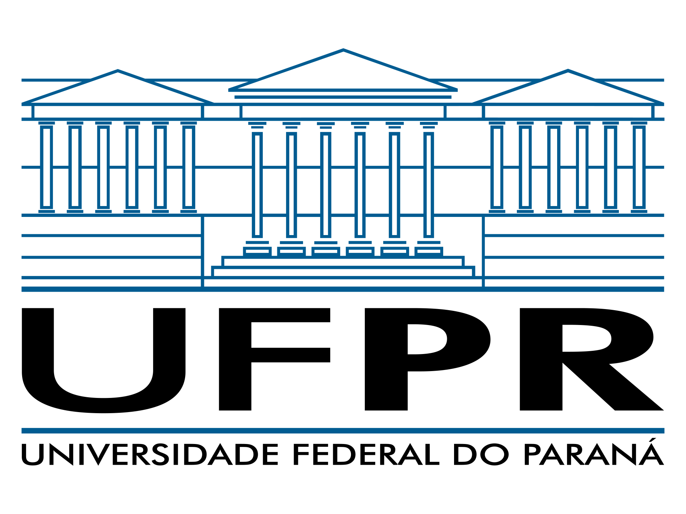
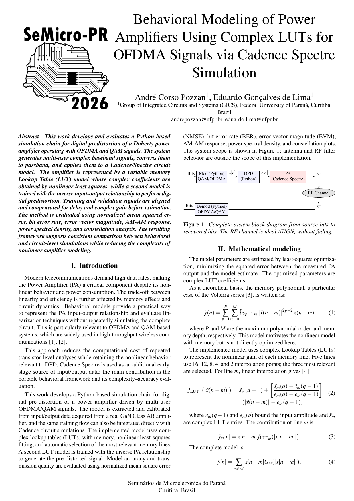
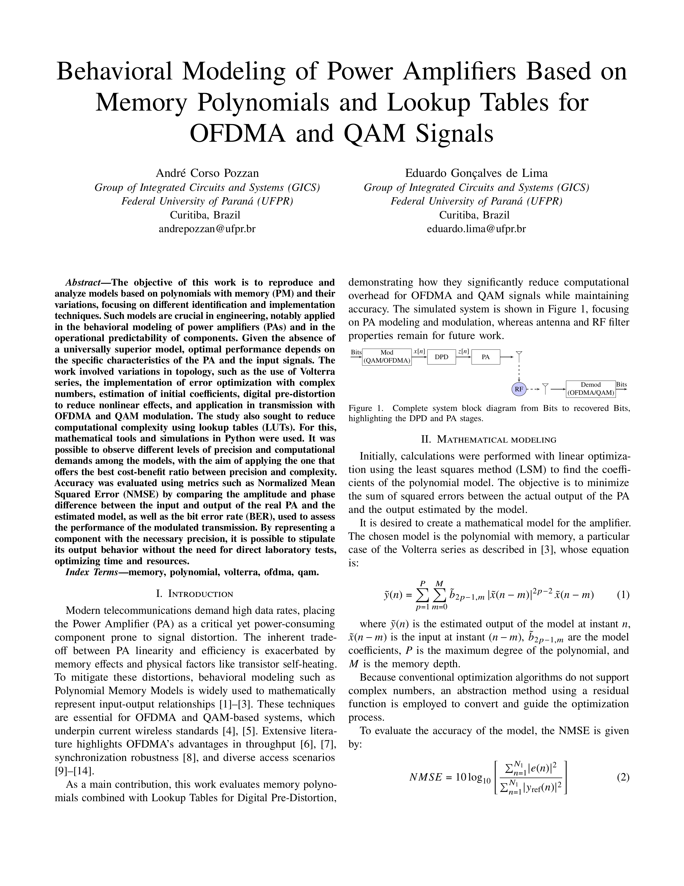
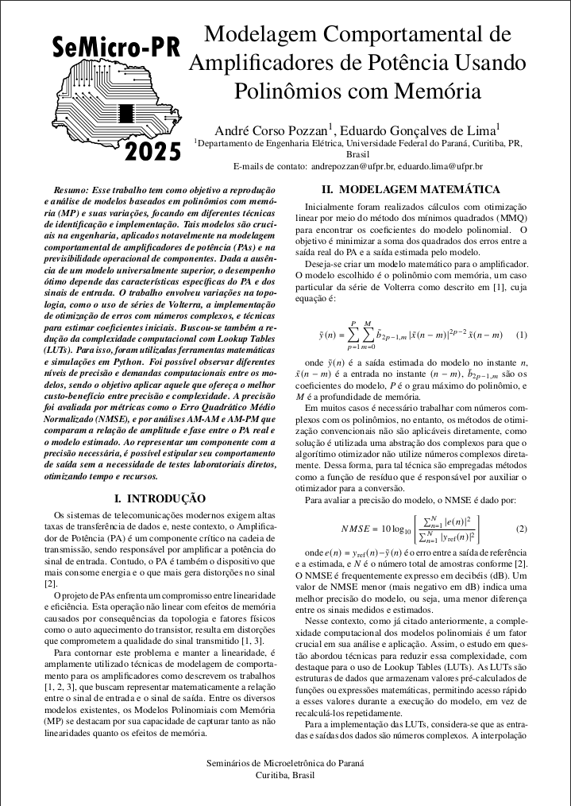
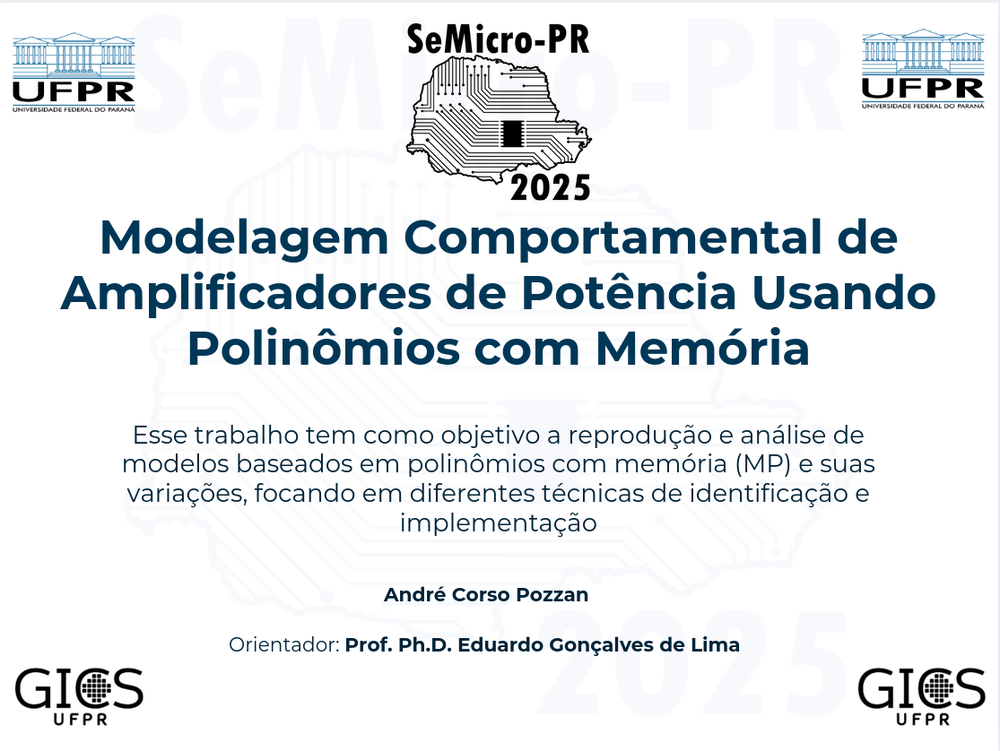
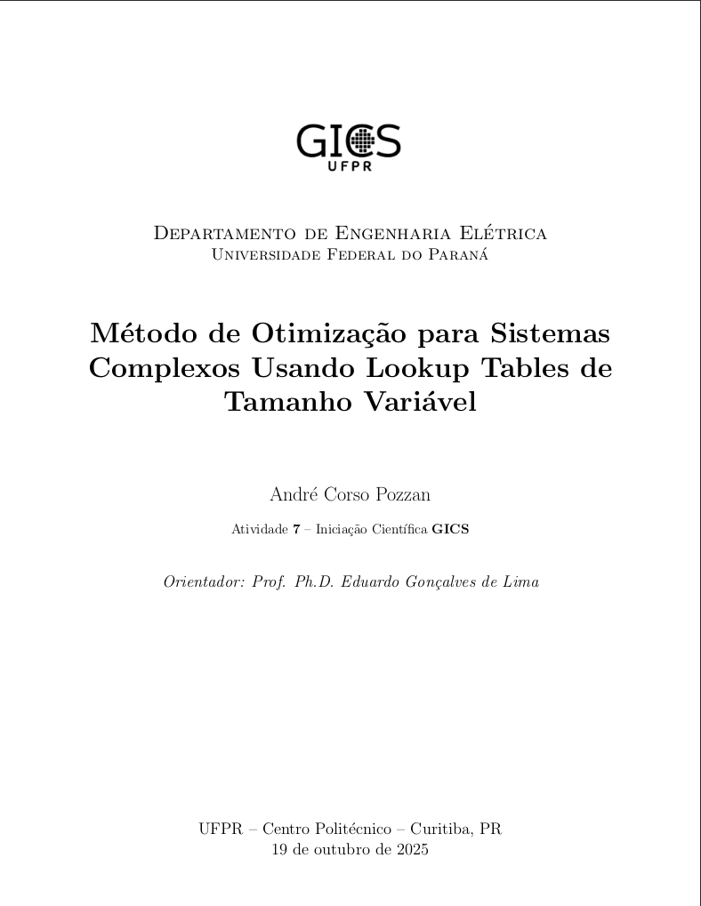

<p align="center">
  
  
  
</p>

# 📂 Repositório de Códigos da Iniciação Científica (GICS)

> Este repositório agrupa todos os scripts e implementações computacionais desenvolvidos ao longo da minha **Iniciação Científica** no grupo GICS. Aqui você encontrará códigos em Python e MATLAB, organizados de acordo com cada atividade/reporte técnico.

---

## 📖 Sobre

<a href="https://gics.ufpr.br/">GICS Website</a>

O **GICS** (Grupo de Concepção de Circuitos e Sistemas Integrados), vinculado à UFPR, tem como objetivo atuar na pesquisa e desenvolvimento de circuitos e sistemas integrados de **radiofrequência (RF)**, **analógicos**, **mistos** e **digitais**, contribuindo para o avanço científico da área e para a formação de recursos humanos altamente especializados.

Composto por professores com experiência internacional, o GICS desenvolve atividades nas seguintes áreas da **microeletrônica**:

- Projetos de circuitos integrados RF e analógicos
- Sistemas digitais e mistos
- Processamento de sinais
- Sistemas embarcados
- Identificação de sistemas não lineares

Este repositório foi criado para:

- **Armazenar** todos os códigos utilizados nos relatórios de Atividades da IC.
- **Facilitar** a reprodução dos experimentos e simulações.
- **Documentar** o uso de métodos de mínimos quadrados, séries de Volterra e modelos de Polinômio com Memória (MP).

---

## 🗂 Estrutura do Repositório

```text
.
├── assets
│   ├── artigo-emicro-sim-capa.png
│   ├── ativ7.png
│   ├── gics-branco.png
│   ├── gics-logo.png
│   ├── logo-ufpr.svg
│   ├── artigo-semicro-2026-capa.png
│   ├── semicro.png
│   └── slides-semicro.png
├── atividades
│   ├── 1-minimos-quadrados
│   ├── 2-in-out-amplificador
│   ├── 3-modelo-mp
│   ├── 4-modelo-nao-linear
│   ├── 5-modelo-nao-linear-complexo
│   ├── 6-luts-interpolacao-linear
│   ├── 7-luts-tamanho-variavel
│   ├── 8-pre-distorcao-com-ofdma
│   ├── 9-cadence-amp
│   └── 10-cadence-rfweblab
├── certificados
│   ├── EMICRO-SIM-2026-apresentacao.pdf
│   ├── EMICRO-SIM-2026-participacao.pdf
│   └── SeMicro2025certificado.pdf
├── README.md
├── relatorios
│   ├── 6A-24-Andre-Pozzan-Behavioral-Modeling-of-Power-Amplifiers-v2.pdf
│   ├── artigo-EMICRO_andrepozzan_v05.pdf
│   ├── artigo-semicro2025-andrepozzan2.pdf.pdf
│   ├── semicro-2026-andrepozzan_v07.pdf
│   ├── Atividade_1_IC_GICS.pdf
│   ├── Atividade_2_IC_GICS.pdf
│   ├── Atividade_3_IC_GICS.pdf
│   ├── Atividade_4_IC_GICS-andrepozzan.pdf
│   ├── Atividade_5_IC_GICS-andrepozzan.pdf
│   ├── Atividade_6_IC_GICS-andrepozzan.pdf
│   ├── Atividade_7_IC_GICS-andrepozzan.pdf
│   └── slides-SEMICRO-final-1.pdf
└── requirements.txt
```

A estrutura atual inclui as atividades de modelagem comportamental, otimização com LUTs, pré-distorção com OFDMA e a etapa mais recente de integração com Cadence para simulação de amplificadores de potência.

---

## ⚙️ Requisitos

Para rodar os scripts Python, é recomendado ter o ambiente virtual com os seguintes pacotes:

```bash
sudo apt update
sudo apt install python3-pip -y

pip install -r requirements.txt
```

---

## 🚀 Instalação & Uso

Clone este repositório e acesse a pasta desejada:

```bash
git clone https://github.com/andrepozzan/ic-gics.git
cd ic-gics/atividades/4-modelo-nao-linear
python3 script.py
```

---

## 📄 Atividades e Entregas

As atividades do repositório seguem uma sequência de desenvolvimento em modelagem comportamental de amplificadores de potência, otimização de parâmetros e validação com sinais complexos e OFDMA. Abaixo estão as principais etapas organizadas no diretório `atividades`.

- 📘 1 - Ajuste Linear via Mínimos Quadrados
- 📗 2 - Série de Volterra em Amplificadores
- 📙 3 - Modelo MP com sinais complexos
- 📕 4 - Modelo Matemático com Otimização Não Linear
- 📘 5 - Modelo Matemático com Otimização Não Linear e Números Complexos
- 📗 6 - Método de Otimização para Sistemas Complexos Usando Lookup Tables e Interpolação Linear
- 📙 7 - Método de Otimização para Sistemas Complexos Usando Lookup Tables de Tamanho Variável
- 📚 8 - Pré-distorção com OFDMA e validação em cenário de comunicação
- 🔧 9 - Integração com Cadence para modelagem e simulação de PA
- ⚙️ 10 - Integração Cadence, RFWebLab e arquivos MAT para validação de PA

### Documentação da Atividade 10

A Atividade 10 possui três fluxos independentes, documentados separadamente:

- [Cadence/Spectre](./atividades/10-cadence-rfweblab/cadence/README.md)
- [RFWebLab](./atividades/10-cadence-rfweblab/python/rfweblab/README.md)
- [Arquivos MAT locais](./atividades/10-cadence-rfweblab/mat/README.md)

O índice geral da atividade está em
[README.md](./atividades/10-cadence-rfweblab/README.md).

> As atividades 8, 9 e 10 representam a etapa mais recente de expansão do repositório, com foco em simulação de amplificadores, OFDMA e integração com o ambiente Cadence.

---

## Artigos publicados


### SeMicro-PR 2026 / UFPR Curitiba-PR

Apresentado em **6 de novembro de 2026**, na **Sessão 4 – Simulação e modelagem de
circuitos**, durante a oitava edição dos Seminários de Microeletrônica do Paraná
(SeMicro-PR), parte da XI Jornada Paranaense de Microeletrônica.

**Behavioral modeling of power amplifiers using complex LUTs for OFDMA signals
via Cadence Spectre simulation**<br />
André Corso Pozzan, Eduardo Gonçalves de Lima

<a href="https://raw.githubusercontent.com/andrepozzan/ic-gics/main/relatorios/semicro-2026-andrepozzan_v07.pdf">Artigo completo</a>

<a href="https://drive.google.com/drive/folders/1-z6m3r9OKnbsho6taP6u9ltoZomf7RB3?usp=drive_link">Slides + artigo</a>

<p align="center">
  
</p>

### SIEPE 2026

[Slides apresentação 17 SIEPE 2026](https://drive.google.com/drive/folders/1XgfV12cw0wUdfeamwUIVT-_iJORr-A-S?usp=sharing)

[Link Canva Slides 17 SIEPE](https://canva.link/fizlpllutdkq2pb)


### EMICRO SIM 2026 / UFSM Santa Maria-RS

<a href="https://sites.google.com/view/emicro-sim-2026/programa%C3%A7%C3%A3o" target="_blank" rel="noopener noreferrer">
  EMicro | SIM 2026 - Programação (12/06 - Sessão 6A)
</a>

<a href="https://raw.githubusercontent.com/andrepozzan/ic-gics/main/relatorios/artigo-EMICRO_andrepozzan_v05.pdf">Artigo completo</a>

<p align="center">
  

### SeMicro-PR 2025 / UFPR Curitiba-PR

Acesse: <a href="https://jpm.ufpr.br/anais/#:~:text=Modelagem comportamental de amplificadores de potência usando polinômios com memória">JPM-Modelagem comportamental de amplificadores de potência usando polinômios com memória</a>

<a href="https://raw.githubusercontent.com/andrepozzan/ic-gics/main/relatorios/artigo-semicro2025-andrepozzan2.pdf.pdf">Artigo completo</a>

<p align="center">
  
<!-- <p align="center">
   -->

<!-- ### Último relatório realizado:

<p align="center">
   -->

## 👤 Autor

Desenvolvido por **André Corso Pozzan**  
Discente de Engenharia Elétrica - UFPR

---
